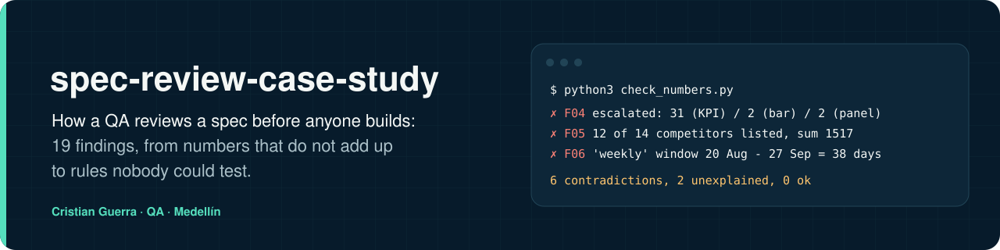

[Read in English](README.md)



## Explicado para un niño de 8 años

Antes de hacer una torta, lees toda la receta. Si en la página 1 dice 3 huevos y en la página 2 dice 2, o si la temperatura del horno está en blanco, paras y preguntas antes de prender el horno. Este proyecto hace eso con un documento técnico que explica cómo construir un programa. Lee cada página, suma cada número y anota todo lo que no cuadra o lo que falta. No se construye nada hasta que alguien responda.

**Un ejemplo real de este caso**

- Imagina que el dueño de una tienda pide un robot que vigile las tiendas rivales cada semana y meta las noticias importantes en una caja de "mira esto" para que una persona las revise.
- El plan del robot dice que esa caja tiene 31 cosas en una esquina de la pantalla y 2 en otra esquina. También lista 12 tiendas rivales cuyos números suman 1.517, mientras el total de arriba dice 2.070.
- La revisión sumó cada número y comparó cada lugar donde aparece lo mismo. Encontró 19 problemas como estos y los volvió preguntas cortas para el dueño.
- Lo que ganamos: cada problema quedó identificado, y con una propuesta de arreglo donde se pudo, con una pregunta en papel antes de que alguien pasara semanas construyendo lo que no era. Ninguno está cerrado todavía: 8 tienen propuesta y 11 siguen abiertos (ver la tabla de hallazgos).


| Palabra difícil | Qué quiere decir |
|---|---|
| Especificación | La receta de un programa: qué hay que construir y cómo debe funcionar |
| QA | La persona que se encarga de encontrar errores antes de que le lleguen a la gente |
| KPI | Un número del marcador que dice cómo van las cosas |
| Requisito | Una cosa que el programa tiene que hacer, escrita |
| Prueba de aceptación | Una revisión que dice "esta parte está lista y funciona" |
| Severidad | Qué tan grave es un problema: ¿frena todo o solo confunde? |

<p>
  
  
  
</p>

## Qué es

Un caso de estudio de QA de requisitos. El dueño de un producto trajo una especificación técnica para una herramienta semanal de vigilancia de competidores: raspadores de posts y anuncios, un monitor de páginas web, un clasificador con LLM que responde cuatro preguntas por señal, reglas para escalar a revisión humana, un resumen de los lunes, un tablero con seis KPI, un esquema de base de datos y un plan de QA. Antes de escribir código se revisó la especificación. La revisión encontró **19 problemas**: 7 números que no cuadran, 3 costos o latencias presentados como hechos y 9 cosas que nadie había definido. Terminó en 7 preguntas para el dueño y un plan por fases en vez de una construcción.

Todo está anonimizado. La especificación se basaba en la demo de otra empresa, así que los nombres de empresas, productos, competidores y personas se cambiaron por genéricos ("Empresa A", "Competidor 1"…), el texto va parafraseado y no se incluye nada del código ni de los datos del producto.

## Cómo funciona


1. **Leer una vez para entender la intención.** Resumir el sistema en 5 líneas y preguntar de dónde salió la especificación. Aquí parecía armada con la captura de la demo de otra empresa, o sea que sus números eran ejemplos, no requisitos.
2. **Recalcular cada número.** Sumar las partes, pasar los conteos a porcentajes del mismo total, contar los días de cada ventana, revisar las unidades.
3. **Cuestionar los "hechos".** Devolver los costos a tokens × precio; comparar cada meta de latencia con la forma en que corre el sistema; preguntar qué comportamiento demuestra cada prueba de aceptación.
4. **Seguir cada definición hasta su origen.** Cada KPI necesita fórmula, cada caja un proveedor y un precio, cada campo un origen (modelo, datos o persona), cada regla una herramienta que la pueda cumplir.
5. **Calificar la severidad.** Bloqueante, Alta o Media.
6. **Decidir.** Cada hallazgo se vuelve una propuesta o una pregunta numerada para el dueño, y la construcción se parte en fases, cada una con su puerta.

## Los hallazgos de un vistazo

| ID | Hallazgo | Severidad | Estado |
|---|---|---|---|
| F01 | Se quitan 422 duplicados, todos de web y ninguno de redes; la regla nunca se describe | Media | Propuesto |
| F02 | El 85 % de las señales son amenazas, pero el 67 % es ruido | Alta | Abierto |
| F03 | El ruido es 67 % como KPI y 4 % como etiqueta | Media | Abierto |
| F04 | Escalados a una persona: 31, 2 y 2 en la misma pantalla; el resumen promete 3 acciones y muestra 2 | Alta | Abierto |
| F05 | Anuncia 14 competidores, lista 12 (suman 1.517 de 2.070) y dibuja 7 | Media | Abierto |
| F06 | La ventana "semanal" dura 38 días | Media | Abierto |
| F07 | "Tokens procesados" cuenta solo la salida, el 1 % de los tokens | Media | Abierto |
| F08 | El gasto semanal cuenta solo la entrada del clasificador | Alta | Propuesto |
| F09 | Meta de latencia e insignia "en vivo" para un lote semanal | Media | Propuesto |
| F10 | Tres pruebas de aceptación repiten los números de la demo | Alta | Propuesto |
| F11 | El clasificador tiene nombre pero no proveedor, endpoint ni precio | Bloqueante | Propuesto |
| F12 | 3 de 6 fórmulas de KPI vacías; el puntaje de amenaza no tiene fórmula | Bloqueante | Abierto |
| F13 | Umbral de 0,85 sobre probabilidades del modelo sin calibrar | Alta | Propuesto |
| F14 | Etiquetas que el modelo no puede saber; una sola etiqueta donde caben dos | Alta | Propuesto |
| F15 | La regla de 14 días mete sola 42 elementos de un competidor en la cola humana | Alta | Abierto |
| F16 | Se le pide a una API de búsqueda detectar cambios; no hay tabla para copias de páginas | Bloqueante | Propuesto |
| F17 | El esquema no deja reclasificar, agrupar por semana ni registrar quién revisó | Alta | Abierto |
| F18 | Faltan nuestra oferta, nuestro comprador y los competidores reales | Bloqueante | Abierto |
| F19 | Raspar las redes sociales grandes incumple sus términos de uso | Alta | Abierto |

Cada uno, con qué decía la especificación, por qué es un problema, cómo se detectó, severidad y decisión: **[docs/findings.es.md](docs/findings.es.md)**.

## Reproducir las cuentas

Los ocho hallazgos numéricos los recalcula, con las cifras de la propia especificación, un script sin dependencias:

```bash
python3 check_numbers.py
```

```text
! F01  1334 + 1158 = 2492 raw, 2070 unique: 422 duplicates (16.9%): 422 web (36.4% of web), 0 social (0.0% of social)
✗ F02  1753 threats = 84.7% of signals, but 67% noise leaves at most 683 non-noise
✗ F03  noise KPI 67% vs 'ignore' label 4% in the taxonomy
✗ F04  escalated: 31 (KPI) / 2 (bar) / 2 (panel); brief promises 3 actions, shows 2
✗ F05  12 of 14 competitors listed, sum 1517: 553 signals (26.7%) unaccounted; graph draws 7
✗ F06  'weekly' window 20 Aug - 27 Sep = 38 days
✗ F07  'tokens processed' 24,849 counts output only; input ~2,070,000 is 98.8% of all tokens
! F08  week spend $0.2087 vs 2.07M input tokens x $0.1/M = $0.2070: classifier input only; output and brief costs missing
6 contradictions, 2 unexplained, 0 ok
assumptions behind F01, F02, F07 and F08: python3 check_numbers.py --assumptions
```

El verificador tiene sus propias pruebas, para que un error suyo no pase en silencio: `python3 -m unittest test_check_numbers` cubre gasto cero, un gasto muy por encima del costo, cero señales y un juego de cifras coherentes que debe pasar. `python3 check_numbers.py --assumptions` lista las estimaciones detrás de F01, F02, F07 y F08.


`✗` es una contradicción y `!` es un número que puede ser cierto pero no está explicado. El script sale con código 1 mientras quede alguno.

## Reutilízala

**[docs/checklist.es.md](docs/checklist.es.md)** es la checklist que dejó esta revisión: 26 revisiones en siete bloques (del 0 al 6), cada una marcada con el hallazgo que la hizo necesaria. Pégala en el ticket antes de que alguien escriba código.

## Límites

- Los niveles de severidad son criterio de quien revisó, no una medición.
- Los hallazgos *Abiertos* seguían esperando respuesta del dueño cuando se escribió este caso; este repo no dice cómo se respondieron.
- Los precios detrás de F08 y del plan por fases eran estimados por verificar antes de pagar.
- La especificación original, el producto y sus datos no están aquí ni van a estar.

## Regenerar la animación

```bash
python3 docs/scenes/export.py
```

Necesita Playwright para Python, Google Chrome y ffmpeg. La escena es `docs/scenes/explained.html`, dibujada en función de `?t=`, así que cada cuadro es determinista.

## Autor

Cristian Guerra · QA · Medellín
