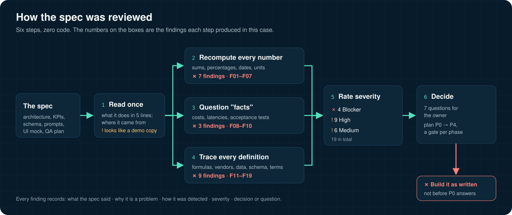

[Leer en español](README.es.md)


## Explained like you're 8

Before you bake a cake, you read the whole recipe. If page 1 says 3 eggs and page 2 says 2 eggs, or the oven temperature is blank, you stop and ask before you turn the oven on. This project does that with a technical document that explains how to build a piece of software. It reads every page, adds up every number, and writes down each thing that does not match or is missing. Nothing gets built until someone answers.

**A real example from this case**

- Imagine a shop owner asks for a robot that watches rival shops every week and puts the important news in a "look at this" box for a person.
- The plan for that robot says the box has 31 items in one corner of the screen and 2 items in another corner. It also lists 12 rival shops whose numbers add up to 1,517, while the total at the top says 2,070.
- The review added up every number and compared every place where the same thing appears. It found 19 problems like these and turned them into short questions for the owner.
- What we gain: each problem was identified, and a fix proposed where possible, with a question on paper before anyone spent weeks building the wrong thing. None is closed yet: 8 have a proposal and 11 are still open (see the findings table).


| Hard word | What it means |
|---|---|
| Spec | The recipe for a piece of software: what to build and how it should work |
| QA | The person whose job is to find mistakes before they reach people |
| KPI | A number on a scoreboard that says how things are going |
| Requirement | One thing the software must do, written down |
| Acceptance test | A check that says "this part is done and it works" |
| Severity | How bad a problem is: does it stop everything, or is it just confusing? |

<p>
  
  
  
</p>

## What this is

A case study in requirements QA. A product owner brought a technical spec for a weekly competitor-tracking tool: scrapers for social posts and ads, a web monitor, an LLM classifier answering four questions per signal, escalation rules for human review, a Monday brief, a dashboard with six KPIs, a database schema and a QA plan. Before writing any code, the spec was reviewed. The review found **19 problems**: 7 numbers that do not add up, 3 costs or latencies stated as facts, and 9 things nobody had defined. It ended with 7 questions for the owner and a phased plan instead of a build.

Everything here is anonymized. The spec was based on someone else's demo, so company, product, competitor and person names are replaced with generic ones ("Company A", "Competitor 1"…), spec text is paraphrased, and none of the product's code or data is included.

## How it works



1. **Read once for intent.** Summarize the system in 5 lines and ask where the spec came from. Here it looked built from a screenshot of another company's demo, which means its numbers were examples, not requirements.
2. **Recompute every number.** Add the parts, turn counts into percentages of the same total, count the days in each window, check the units.
3. **Question the "facts".** Work costs back to tokens × price; check each latency target against how the system runs; ask what behaviour each acceptance test proves.
4. **Trace every definition.** Every KPI needs a formula, every box a vendor and a price, every field a source (model, data or person), every rule a tool that can do it.
5. **Rate severity.** Blocker, High or Medium.
6. **Decide.** Each finding becomes a proposal or a numbered question for the owner, and the build is cut into phases with a gate each.

## The findings at a glance

| ID | Finding | Severity | Status |
|---|---|---|---|
| F01 | 422 duplicates removed, all from web, none from social; dedup rule never described | Medium | Proposed |
| F02 | 85 % of signals are threats, yet 67 % are noise | High | Open |
| F03 | Noise is 67 % as a KPI and 4 % as a label | Medium | Open |
| F04 | Escalated to a human: 31, 2 and 2 on the same screen; brief promises 3 actions, shows 2 | High | Open |
| F05 | 14 competitors claimed, 12 listed (sum 1,517 of 2,070), 7 drawn | Medium | Open |
| F06 | "Weekly" window lasts 38 days | Medium | Open |
| F07 | "Tokens processed" counts output only, 1 % of the tokens | Medium | Open |
| F08 | Weekly spend counts only the classifier's input | High | Proposed |
| F09 | Latency target and a "live" badge on a weekly batch | Medium | Proposed |
| F10 | Three acceptance tests replay the demo's numbers | High | Proposed |
| F11 | Classifier has a name, no vendor, endpoint or price | Blocker | Proposed |
| F12 | 3 of 6 KPI formulas blank; risk score has no formula | Blocker | Open |
| F13 | 0.85 threshold on uncalibrated model probabilities | High | Proposed |
| F14 | Labels the model cannot know; one label where two apply | High | Proposed |
| F15 | The 14-day rule alone puts 42 items from one competitor in the human queue | High | Open |
| F16 | A search API is asked to detect page changes; no table for page copies | Blocker | Proposed |
| F17 | Schema cannot reclassify, group by week or record who reviewed | High | Open |
| F18 | Our own offer, buyer and real competitors are missing | Blocker | Open |
| F19 | Scraping the big social networks breaks their terms of use | High | Open |

Each one, with what the spec said, why it is a problem, how it was detected, severity and decision: **[docs/findings.md](docs/findings.md)**.

## Reproduce the arithmetic

The eight numeric findings are recomputed from the spec's own figures by a script with no dependencies:

```bash
python3 check_numbers.py
```

```text
! F01  1334 + 1158 = 2492 raw, 2070 unique: 422 duplicates (16.9%): 422 web (36.4% of web), 0 social (0.0% of social)
✗ F02  1753 threats = 84.7% of signals, but 67% noise leaves at most 683 non-noise
✗ F03  noise KPI 67% vs 'ignore' label 4% in the taxonomy
✗ F04  escalated: 31 (KPI) / 2 (bar) / 2 (panel); brief promises 3 actions, shows 2
✗ F05  12 of 14 competitors listed, sum 1517: 553 signals (26.7%) unaccounted; graph draws 7
✗ F06  'weekly' window 20 Aug - 27 Sep = 38 days
✗ F07  'tokens processed' 24,849 counts output only; input ~2,070,000 is 98.8% of all tokens
! F08  week spend $0.2087 vs 2.07M input tokens x $0.1/M = $0.2070: classifier input only; output and brief costs missing
6 contradictions, 2 unexplained, 0 ok
assumptions behind F01, F02, F07 and F08: python3 check_numbers.py --assumptions
```

The checker has its own tests, so a bug in it cannot pass silently: `python3 -m unittest test_check_numbers` covers zero spend, a spend far above cost, no signals at all, and a set of consistent numbers that must pass. `python3 check_numbers.py --assumptions` lists the estimates behind F01, F02, F07 and F08.


`✗` is a contradiction, `!` is a number that can be true but is not explained. The script exits with code 1 while any of them remain.

## Reuse it

**[docs/checklist.md](docs/checklist.md)** is the checklist distilled from this review: 26 checks in seven blocks (0 to 6), each tagged with the finding that made it necessary. Paste it into the ticket before anyone writes code.

## Limits

- Severity levels are the reviewer's judgment, not a measurement.
- Findings marked *Open* were still waiting on the owner when this case was written; this repo does not say how they were answered.
- Prices behind F08 and the phased plan were estimates to verify before paying.
- The original spec, the product and its data are not here and will not be.

## Regenerate the animation

```bash
python3 docs/scenes/export.py
```

Needs Python Playwright, Google Chrome and ffmpeg. The scene is `docs/scenes/explained.html`, drawn as a function of `?t=`, so every frame is deterministic.

## Author

Cristian Guerra · QA · Medellín
